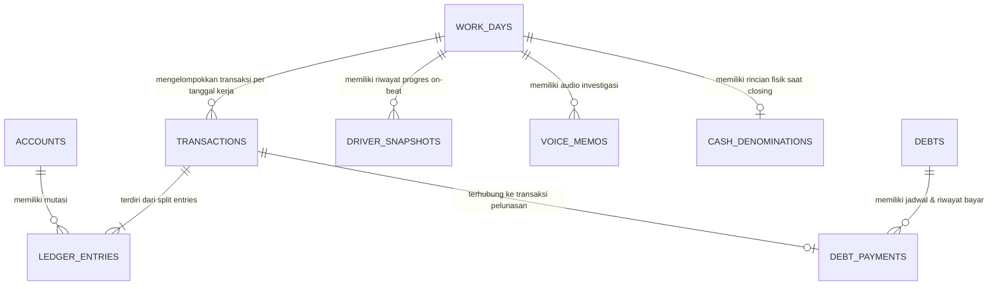

# DATA MODEL SPECIFICATION (DATA-MODEL.md)
**Status:** SPESIFIKASI BAKU DATABASE  
**Database Engine:** MySQL 8.x (Testing: SQLite in-memory)  
**Satuan Uang:** `BIGINT` (Rupiah utuh, presisi Rp1, tanpa desimal float)

---

## 1. Diagram Relasi Entitas (ERD)



---

## 2. Rincian Tabel Database

### A. Tabel `accounts` (Master Akun Keuangan)
Menyimpan rekening bank, e-wallet, uang fisik, dan akun beban/pendapatan.
```sql
CREATE TABLE accounts (
    id BIGINT UNSIGNED AUTO_INCREMENT PRIMARY KEY,
    name VARCHAR(100) NOT NULL, -- Contoh: "BCA", "ShopeePay", "Cash", "Beban Sedekah"
    type ENUM('bank', 'ewallet', 'cash', 'income', 'expense', 'debt', 'receivable') NOT NULL,
    current_balance BIGINT NOT NULL DEFAULT 0, -- Saldo berjalan (di-update via ledger)
    initial_balance BIGINT NOT NULL DEFAULT 0, -- Saldo awal saat setup
    is_active BOOLEAN NOT NULL DEFAULT TRUE,
    created_at TIMESTAMP NULL,
    updated_at TIMESTAMP NULL
);
```

### B. Tabel `work_days` (Tanggal Kerja Driver & Status Closing)
Mengelola tanggal kerja terpisah dari waktu sistem.
```sql
CREATE TABLE work_days (
    id BIGINT UNSIGNED AUTO_INCREMENT PRIMARY KEY,
    work_date DATE NOT NULL UNIQUE, -- Tanggal kerja (misal: 2026-10-12)
    status ENUM('needs_reconciliation', 'final') NOT NULL DEFAULT 'needs_reconciliation',
    opened_at TIMESTAMP NOT NULL,
    closed_at TIMESTAMP NULL,
    total_orders INT UNSIGNED NOT NULL DEFAULT 0,
    online_hours DECIMAL(4,2) NULL, -- Waktu online (misal 9.25 jam)
    is_performance_eligible BOOLEAN NOT NULL DEFAULT FALSE, -- Apakah online >= 9 jam
    closing_notes TEXT NULL,
    created_at TIMESTAMP NULL,
    updated_at TIMESTAMP NULL
);
```

### C. Tabel `transactions` (Header Transaksi)
Menjadi payung setiap transaksi keuangan.
```sql
CREATE TABLE transactions (
    id BIGINT UNSIGNED AUTO_INCREMENT PRIMARY KEY,
    work_day_id BIGINT UNSIGNED NOT NULL,
    category_id BIGINT UNSIGNED NULL,
    type ENUM('expense', 'income', 'transfer', 'adjustment', 'reversal') NOT NULL,
    description VARCHAR(255) NOT NULL,
    transaction_time TIMESTAMP NOT NULL, -- Waktu aktual kejadian
    is_estimated_time BOOLEAN NOT NULL DEFAULT FALSE, -- Jika 23:59 placeholder
    metadata JSON NULL, -- Menyimpan data tambahan (lokasi GPS, resto, dsb)
    created_at TIMESTAMP NULL,
    updated_at TIMESTAMP NULL,
    FOREIGN KEY (work_day_id) REFERENCES work_days(id)
);
```

### D. Tabel `ledger_entries` (Multi-entry Ledger)
Menjamin integritas saldo (Double-entry accounting).
```sql
CREATE TABLE ledger_entries (
    id BIGINT UNSIGNED AUTO_INCREMENT PRIMARY KEY,
    transaction_id BIGINT UNSIGNED NOT NULL,
    account_id BIGINT UNSIGNED NOT NULL,
    entry_type ENUM('debit', 'credit') NOT NULL,
    amount BIGINT NOT NULL, -- Nominal Rupiah utuh (>= 0)
    created_at TIMESTAMP NULL,
    FOREIGN KEY (transaction_id) REFERENCES transactions(id) ON DELETE RESTRICT,
    FOREIGN KEY (account_id) REFERENCES accounts(id) ON DELETE RESTRICT
);
```

### E. Tabel `driver_snapshots` (Riwayat Input Progres On-Beat)
Menyimpan progres saat di jalan tanpa menimpa data sebelumnya.
```sql
CREATE TABLE driver_snapshots (
    id BIGINT UNSIGNED AUTO_INCREMENT PRIMARY KEY,
    work_day_id BIGINT UNSIGNED NOT NULL,
    recorded_at TIMESTAMP NOT NULL,
    completed_orders INT UNSIGNED NOT NULL DEFAULT 0,
    hub_income BIGINT NOT NULL DEFAULT 0,
    hub_bonus BIGINT NOT NULL DEFAULT 0,
    customer_tips BIGINT NOT NULL DEFAULT 0,
    shopeepay_balance BIGINT NOT NULL DEFAULT 0,
    gopay_balance BIGINT NOT NULL DEFAULT 0,
    gopay_merchant_balance BIGINT NOT NULL DEFAULT 0,
    created_at TIMESTAMP NULL,
    FOREIGN KEY (work_day_id) REFERENCES work_days(id)
);
```

### F. Tabel `voice_memos` (Audio Rekaman Intercom Helm)
Menyimpan metadata dan file audio pendukung investigasi.
```sql
CREATE TABLE voice_memos (
    id BIGINT UNSIGNED AUTO_INCREMENT PRIMARY KEY,
    work_day_id BIGINT UNSIGNED NOT NULL,
    file_path VARCHAR(255) NOT NULL,
    duration_seconds INT UNSIGNED NULL,
    latitude DECIMAL(10, 8) NULL,
    longitude DECIMAL(11, 8) NULL,
    transcription_text TEXT NULL, -- Kosong di MVP, siap untuk fitur AI masa depan
    recorded_at TIMESTAMP NOT NULL,
    created_at TIMESTAMP NULL,
    FOREIGN KEY (work_day_id) REFERENCES work_days(id)
);
```

### G. Tabel `cash_denominations` (Hitung Fisik Closing)
Menyimpan jumlah lembar/koin saat closing malam.
```sql
CREATE TABLE cash_denominations (
    id BIGINT UNSIGNED AUTO_INCREMENT PRIMARY KEY,
    work_day_id BIGINT UNSIGNED NOT NULL UNIQUE,
    coin_100 INT UNSIGNED NOT NULL DEFAULT 0,
    coin_200 INT UNSIGNED NOT NULL DEFAULT 0,
    coin_500 INT UNSIGNED NOT NULL DEFAULT 0,
    coin_1000 INT UNSIGNED NOT NULL DEFAULT 0,
    bill_1000 INT UNSIGNED NOT NULL DEFAULT 0,
    bill_2000 INT UNSIGNED NOT NULL DEFAULT 0,
    bill_5000 INT UNSIGNED NOT NULL DEFAULT 0,
    bill_10000 INT UNSIGNED NOT NULL DEFAULT 0,
    bill_20000 INT UNSIGNED NOT NULL DEFAULT 0,
    bill_50000 INT UNSIGNED NOT NULL DEFAULT 0,
    bill_100000 INT UNSIGNED NOT NULL DEFAULT 0,
    total_physical_amount BIGINT NOT NULL DEFAULT 0,
    created_at TIMESTAMP NULL,
    updated_at TIMESTAMP NULL,
    FOREIGN KEY (work_day_id) REFERENCES work_days(id)
);
```

### H. Tabel `audit_logs` (Rekam Jejak Koreksi & Immutability)
Mencatat alasan dan nilai lama jika ada transaksi yang dikoreksi.
```sql
CREATE TABLE audit_logs (
    id BIGINT UNSIGNED AUTO_INCREMENT PRIMARY KEY,
    auditable_type VARCHAR(100) NOT NULL,
    auditable_id BIGINT UNSIGNED NOT NULL,
    action ENUM('create', 'update', 'reversal') NOT NULL,
    old_values JSON NULL,
    new_values JSON NULL,
    reason TEXT NOT NULL,
    created_at TIMESTAMP NOT NULL
);
```
