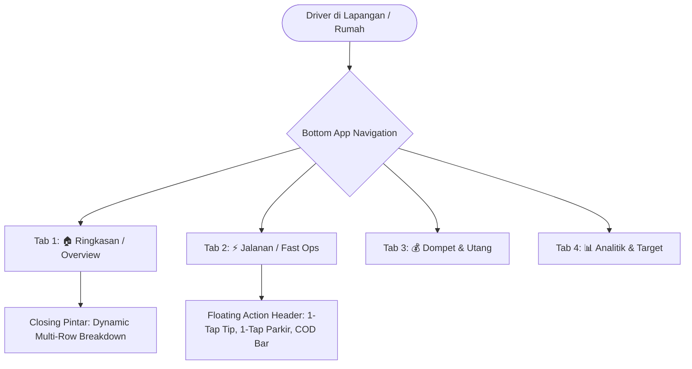

# 🚀 MASTERPLAN RENOVASI ARSITEKTUR & UX V2 (MOBILE-FIRST)
## Aplikasi Keuangan Pribadi & ShopeeFood Driver

> **Dokumen Spesifikasi Teknis & Roadmap Renovasi**  
> **Status:** Siap Eksekusi (Multi-Part Autonomous Roadmap)  
> **Target:** Kualitas Maksimal, Pengalaman Pengguna (UX) Ergonomis, Bebas Scrolling Panjang, Presisi Finansial Rp1.

---

## 1. Analisa Masalah Utama (Pain Points Audit)

Berdasarkan evaluasi penggunaan nyata di lapangan oleh driver:

1. **Endless Scrolling Fatigue (Kelelahan Scroll Panjang)**:
   - Dashboard web saat ini menumpuk seluruh widget (Kartu Saldo, Quick Action, Transaksi Cepat, Kotak Hitam Audio, Tabel Multi-Tanggal, Checkpoint Snapshot, Target Keuangan, Riwayat Transaksi) dalam satu halaman vertikal raksasa.
   - Driver yang baru pulang narik dalam kondisi fisik lelah harus melakukan puluhan kali *swipe/scroll* hanya untuk mencari tombol input tip atau parkir.
2. **Tombol Krusial Lapangan Terkubur**:
   - Fitur esensial jalanan seperti **Input Tip Pelanggan Cepat**, **Parkir Motor Cepat (Rp 1.000 / Rp 2.000)**, dan **Orderan COD** posisinya tenggelam di tengah halaman.
3. **Closing & Finalisasi Kaku (Single-Input Limitation)**:
   - Saat closing malam hari dan ditemukan selisih fisik (misalnya selisih Rp 50.000), modal closing hanya menyediakan **satu kolom teks kaku**.
   - Driver terpaksa mengetik narasi panjang manual. Seharusnya sistem menyediakan **Dynamic Multi-Row Item Breakdown** (tambah baris dinamis: baris 1 Parkir Rp2.000, baris 2 Tempe Rp5.000, baris 3 Tahu Rp4.000, dll) yang otomatis menjumlahkan dan mengalokasikan selisih ke kategori masing-masing.
4. **Laporan & Analitik Pasif**:
   - Modul analitik hanya menampilkan angka statis tanpa memberikan proyeksi aksi nyata (*Actionable Insight*): Rasio Likuiditas vs Target Pelunasan Utang, *Debt Freedom Countdown*, dan Runway Pengeluaran Harian.

---

## 2. Arsitektur Baru: Mobile-First Tabbed Navigation

Alih-alih menumpuk semuanya dalam satu halaman scroll, antarmuka dirombak menjadi **4 View Modular** dengan **Bottom Navigation Bar (App Bar Bawah)** yang selalu menempel di layar ponsel (*sticky bottom*):

### Rincian 4 Tab Navigasi:
1. **Tab 1: 🏠 Ringkasan (Home / Dashboard Eksekutif)**:
   - Saldo Bersih (*Net Worth*), Total Uang Kas Fisik, Total Bank/e-Wallet.
   - Status Shift Hari Ini (Aktif / Belum Buka) & Shortcut Finalisasi Malam.
   - Widget *Debt Freedom Target* (Countdown Pelunasan Total per 30 Oktober).
2. **Tab 2: ⚡ Jalanan (Fast Operational Hub)**:
   - **Floating Action Dock (Sticky Atas)**:
     - `[🪙 +Tip Kas Cepat]` (Pilihan 1k, 2k, 5k, 10k, Custom)
     - `[🅿️ Parkir 1-Tap]` (Preset 1.000 / 2.000 dengan GPS auto-tag)
     - `[📦 Orderan COD]` (Modal cepat catat talangan & penyelesaian COD)
   - Kotak Hitam Memo Suara Helm (Audio + GPS).
   - Spreadsheet Input Cepat Multi-Tanggal (Tgl 20, 21, 22, 23).
3. **Tab 3: 💰 Dompet & Utang (Wallets & Liabilities)**:
   - Daftar Rincian Saldo (BCA, ShopeePay, GoPay, Cash Dompet, e-Money).
   - Tabel Utang Aktif (SeaBank, SPayLater, Utang Teman Kokari, TikTok).
   - Kalkulator Pecahan Kas Fisik (Denominasi Uang Logam & Kertas).
4. **Tab 4: 📊 Analitik & Target (Reports & Runway)**:
   - Kalkulator Target Narik Harian menuju 30 Oktober.
   - Grafik Pengeluaran vs Pemasukan Narik.
   - Target Kebutuhan Hidup & Wisuda (Sewa Hotel Rp 250.000).

---

## 3. Spesifikasi Fitur Unggulan Baru

### A. Dynamic Multi-Row Breakdown pada Closing / Finalisasi
Saat malam hari driver melakukan closing shift dan terdapat selisih uang kas (misal selisih Rp 50.000):
* Tampil modal interaktif dengan spreadsheet mini:
  | # | Kategori | Keterangan Barang | Wadah Uang | Nominal (Rp) | Aksi |
  |---|---|---|---|---|---|
  | 1 | Parkir | Parkir minimarket & resto | Cash | Rp 4.000 | ✕ |
  | 2 | Makanan | Tempe & tahu warung | Cash | Rp 15.000 | ✕ |
  | 3 | Bensin | Bensin eceran darurat | Cash | Rp 15.000 | ✕ |
  | 4 | Lain-lain | Sisa uang receh tercecer | Cash | Rp 16.000 | ✕ |
* **Fitur Real-time Balancer**: Total baris pecahan dihitung otomatis dan mencocokkan selisih hingga Rp 0. Driver tidak perlu lagi mengetik teks panjang di satu kotak teks.

### B. Floating Quick Action Header (Zero-Scroll Speed)
Pada Tab Jalanan (*Fast Ops*), 3 aksi paling sering digunakan driver ditempatkan di bilah atas yang tidak pernah hilang saat layar disentuh:
* **Tombol Tip 1-Tap**: Popover instan berisi pilihan Rp1.000, Rp2.000, Rp3.000, Rp5.000, Rp10.000, atau Custom. Langsung tersimpan ke buku besar tanpa reload halaman.
* **Tombol Parkir 1-Tap**: 1 sentuhan untuk parkir Rp 1.000 / Rp 2.000 langsung memotong kas dompet.
* **Tombol COD Express**: Langsung buka drawer input pesanan COD tanpa perlu mencari-cari di bawah.

---

## 4. Rencana Eksekusi Multi-Part (Autonomous Roadmap)

Pekerjaan renovasi dipecah menjadi bagian-bagian terstruktur (*modular parts*):

* **PART 1: Sinkronisasi Data Riil & Pencatatan Kewajiban Baru [SELESAI]**
  - Update saldo aktual: BCA Rp 805.574, Cash Rp 888.000, ShopeePay Rp 64.326, GoPay Rp 27.288, GoPay Merchant Rp 2.000.
  - Catat Utang Teman (Makan Kokari Malang) Rp 150.000.
  - Catat Financial Goal: Sewa Hotel Wisuda Rp 250.000.
  - Update data orderan ShopeeFood 20–23 Oktober (50 order selesai).

* **PART 2: Mobile Bottom Navigation Architecture & View Splitting**
  - Memecah `resources/views/dashboard/index.blade.php` menjadi view parsial bersih:
    - `partials/nav-bottom.blade.php` (Bottom Tab Bar sticky)
    - `partials/tab-home.blade.php` (Ringkasan Net Worth & Status)
    - `partials/tab-operational.blade.php` (Jalanan & Fast Ops)
    - `partials/tab-wallets-debts.blade.php` (Dompet & Utang)
    - `partials/tab-analytics.blade.php` (Laporan & Target)
  - Transisi tab instan via JavaScript murni (tanpa reload halaman yang lambat).

* **PART 3: Floating Action Dock (Fast Tip, Fast Parking, Fast COD)**
  - Mengimplementasikan bilah aksi cepat di bagian atas tab operasional.
  - Endpoint AJAX instan untuk tip dan parkir agar tidak me-refresh browser.

* **PART 4: Dynamic Multi-Row Closing Breakdown**
  - Mengganti single-input kaku pada modal closing shift di `resources/views/closing/show.blade.php` dan dashboard dengan form tabel baris dinamis (*add row / delete row*).
  - Validasi backend di `ClosingWebController` untuk menyimpan baris pecahan transaksi selisih secara otomatis ke buku besar.

* **PART 5: Modul Runway Bebas Utang 30 Oktober & Visualisasi Analitik**
  - Indikator visual progres pelunasan total menuju 30 Oktober.
  - Widget hitung mundur target harian narik (Rp 65.000 – Rp 75.000/hari).

* **PART 6: Automated Testing Suite & Verifikasi Zero-Regression**
  - Pembuatan automated feature tests untuk arsitektur navigasi baru dan dynamic multi-row closing.
  - Memastikan 100% test lulus dan deploy ke production server.
